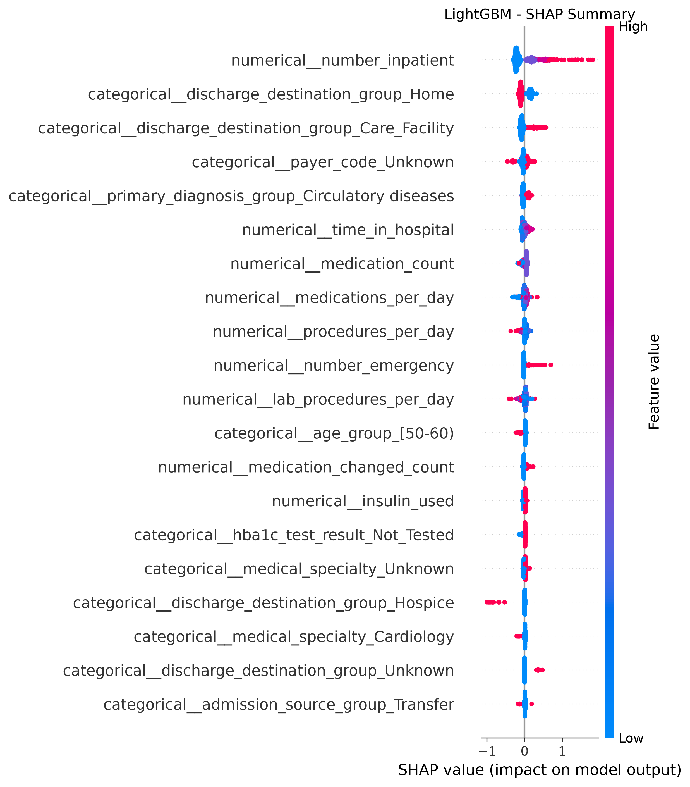
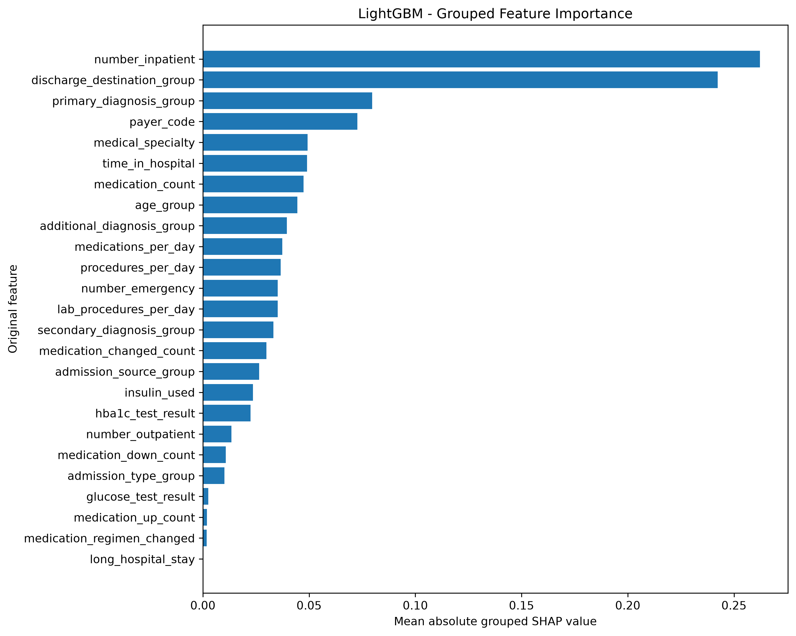
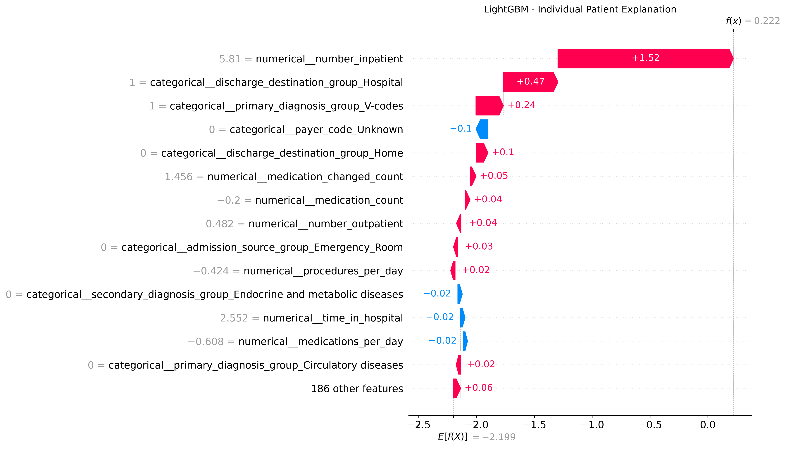
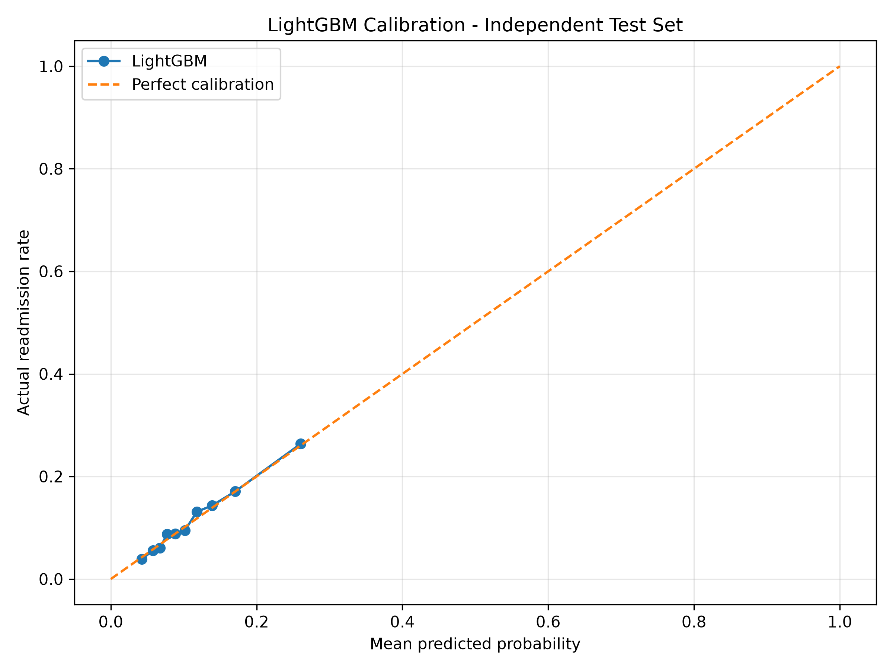
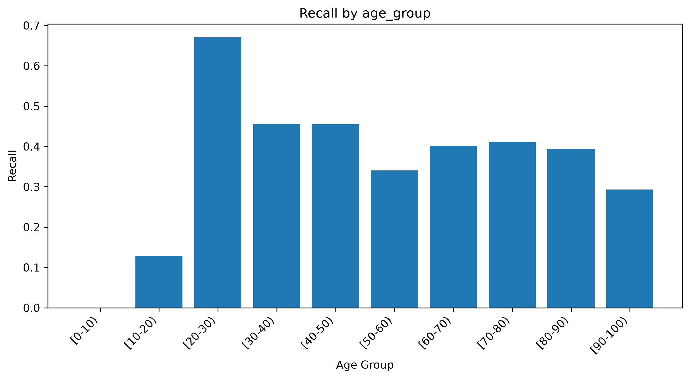
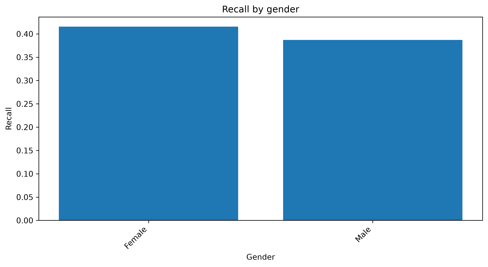

# Diabetes 30-Day Hospital Readmission Prediction

An end-to-end machine learning project to predict the risk of hospital readmission within 30 days for patients with diabetes. The project covers data quality, exploratory analysis, feature engineering, model development, explainability, fairness evaluation and REST API deployment.

---

## Project Overview

Hospital readmission is an important challenge in healthcare. Identifying patients who may return to hospital within 30 days can help healthcare teams prioritize follow-up and improve discharge planning.

This project develops a machine learning system that estimates the probability of 30-day hospital readmission using historical hospital encounter data.

**Business objective:** Identify higher-risk encounters and support data-driven discharge planning and follow-up prioritization.

**Project domain:** Healthcare Analytics

**Project type:** End-to-End Data Science and Machine Learning

---

## Dataset

**Dataset:** Diabetes 130-US Hospitals for Years 1999–2008

**Source:** [UCI Machine Learning Repository – Diabetes 130-US Hospitals](https://archive.ics.uci.edu/dataset/296/diabetes+130+us+hospitals+for+years+1999+2008)

The dataset contains historical hospital encounters for patients with diabetes.

| Dataset information | Value |
|---|---:|
| Original encounters | 101,766 |
| Original features | 50 |
| Unique patients | 71,518 |
| Eligible encounters | 100,114 |
| Excluded encounters | 1,652 |
| Readmission within 30 days | 11.16% |

### Target Definition

The original target contains three categories:

- `NO` – No readmission.
- `>30` – Readmission after 30 days.
- `<30` – Readmission within 30 days.

For binary classification:

- `<30` = 1 (readmitted within 30 days)
- `NO` and `>30` = 0 (not readmitted within 30 days)

Death-related discharge encounters were excluded from the modelling cohort.

---

## Project Workflow

1. Data loading and validation
2. Data quality assessment
3. Exploratory data analysis
4. Patient-level cohort selection
5. Train/test splitting
6. Feature engineering
7. Data preprocessing
8. Model development and comparison
9. Hyperparameter tuning
10. Model evaluation and calibration
11. SHAP explainability
12. Fairness evaluation
13. FastAPI prediction service
14. Automated testing and code quality

---

## Data Preparation and Quality

The data preparation process includes:

- Missing-value analysis
- Duplicate encounter validation
- Constant-column identification
- Categorical and numerical feature analysis
- Admission and discharge mapping
- Diagnosis analysis
- Patient encounter history analysis
- Data quality and feature availability audits

High-missingness columns such as weight, glucose serum results and HbA1c results were investigated.

Missing glucose and HbA1c results were represented as `Not_Tested` in engineered features, indicating that no result was recorded.

---

## Feature Engineering

The project creates 27 engineered features across different categories.

| Feature category | Examples |
|---|---|
| Diagnosis | Primary, secondary and additional diagnosis groups |
| Medication | Medication count, medication changes, insulin usage |
| Visit history | Previous inpatient, outpatient and emergency visits |
| Admission | Admission type, admission source, discharge destination |
| Demographic | Age group, gender group, race group |
| Hospital stay | Procedures per day, medications per day, length of stay |
| Clinical | Glucose and HbA1c test-result availability |

### Final Model Features

The selected model uses 25 predictors:

- 14 numerical features
- 11 categorical features

Race and gender were excluded from model predictors and retained for fairness evaluation.

The prediction point is assumed to be discharge, after discharge destination and medication reconciliation have been finalized.

---

## Model Development

Four machine learning algorithms were evaluated:

1. Logistic Regression
2. Random Forest
3. XGBoost
4. LightGBM

Hyperparameter tuning was performed for XGBoost and LightGBM.

### Validation Strategy

To avoid patient-level data leakage, the project uses `StratifiedGroupKFold` with patient identifiers as groups.

- Training encounters: 80,090
- Test encounters: 20,024
- No patient overlap between training and test sets.
- Cross-validation: 5 folds.

Numerical preprocessing uses median imputation and standard scaling.

Categorical preprocessing uses most-frequent imputation and one-hot encoding.

Preprocessing is fitted inside each training fold to prevent data leakage.

---

## Final Model: LightGBM

LightGBM was selected based on its cross-validation performance.

### Independent Test Results

| Metric | Result |
|---|---:|
| Test encounters | 20,024 |
| Actual readmissions | 2,272 |
| Readmission prevalence | 11.35% |
| PR-AUC | 0.2145 |
| ROC-AUC | 0.6708 |
| Brier score | 0.0963 |
| Precision | 0.2140 |
| Recall | 0.3935 |
| F1-score | 0.2772 |

Precision, recall and F1-score are measured at the analytical threshold of 0.15.

### Confusion Matrix

| | Predicted No Readmission | Predicted Readmission |
|---|---:|---:|
| Actual No Readmission | 14,468 | 3,284 |
| Actual Readmission | 1,378 | 894 |

The model flagged 4,178 encounters, representing 20.86% of the test set.

The threshold of 0.15 is an analytical reference, not a clinically approved decision threshold.

---

## Model Explainability

SHAP (SHapley Additive exPlanations) is used to understand model behaviour.

The analysis includes:

- Global feature importance
- Grouped feature importance
- Individual encounter explanations

Important model features include:

- Previous inpatient visits
- Discharge destination
- Primary diagnosis group
- Payer code
- Medical specialty
- Length of hospital stay
- Medication count
- Age group

SHAP values describe the model's learned associations. They do not establish clinical causation.

---

## Model Calibration

The final model was evaluated using an independent test set.

| Calibration metric | Result |
|---|---:|
| Mean predicted risk | 11.23% |
| Actual readmission rate | 11.35% |
| Brier score | 0.0963 |

The predicted probabilities were reasonably close to observed readmission rates across ten equal-sized risk groups.

This assessment does not establish calibration in contemporary hospital populations.

---

## Fairness Evaluation

The project evaluates model performance across:

- Age groups
- Gender groups
- Race groups

Metrics include:

- Precision
- Recall
- False positive rate
- Confidence intervals
- Patient-level bootstrap confidence intervals

Fairness results are exploratory. Some demographic groups have small sample sizes, so their estimates require cautious interpretation.

The project does not claim that the model is free from bias.

---

## REST API – FastAPI

The trained LightGBM model is exposed through a FastAPI application.

### Available Endpoints

| Method | Endpoint | Description |
|---|---|---|
| GET | `/` | API welcome message |
| GET | `/health` | Application health check |
| POST | `/predict` | Predict readmission risk |

### Run Locally

Install dependencies:

```bash
uv sync
```

Start the API:

```bash
uv run python run.py
```

Open Swagger documentation:

[http://127.0.0.1:8000/docs](http://127.0.0.1:8000/docs)

### Prediction Output

The API returns:

- Predicted probability
- Predicted status (`High Risk` or `Lower Risk`)

The current prediction endpoint expects the 25 engineered model features. It does not yet accept raw hospital records and automatically perform the full feature-engineering process.

---

## Testing and Code Quality

Automated tests cover:

- Prediction input validation
- Missing features
- Invalid numerical values
- Missing categorical values
- Multiple encounter predictions
- API endpoints
- API configuration

**Current validation results:**

- Pytest: 11 tests passed
- Ruff lint: All checks passed
- Ruff formatting: All files formatted

Run tests:

```bash
uv run pytest -v
```

Run lint:

```bash
uv run ruff check src api config tests run.py
```

Check formatting:

```bash
uv run ruff format --check src api config tests run.py
```

---

## Project Structure

```text
project1_Diabetes 30-Day Hospital Readmission Prediction/
│
├── api/
│   └── main.py
│
├── artifacts/
│   └── Trained model pipelines
│
├── config/
│   ├── logging_config.py
│   └── settings.py
│
├── data/
│   ├── raw/
│   ├── interim/
│   └── processed/
│
├── notebooks/
│
├── reports/
│   ├── business_insights/
│   ├── data_quality/
│   ├── figures/
│   └── model_evaluation/
│
├── src/
│   ├── analysis/
│   ├── data_pipeline/
│   ├── explainability/
│   ├── features/
│   └── models/
│
├── tests/
│   ├── test_api.py
│   └── test_prediction.py
│
├── .env.example
├── .gitignore
├── .python-version
├── pyproject.toml
├── README.md
├── run.py
└── uv.lock
```

---

## Technologies

| Category | Technologies |
|---|---|
| Programming | Python |
| Data processing | Pandas, NumPy |
| Machine learning | Scikit-learn, LightGBM, XGBoost |
| Explainability | SHAP |
| API | FastAPI, Pydantic |
| Data visualization | Matplotlib, Seaborn |
| Model persistence | Joblib |
| Testing | Pytest |
| Code quality | Ruff |
| Environment | uv |
| Version control | Git |

---

## Limitations

- The dataset contains historical records from 1999–2008.
- Model performance may not generalize to modern hospitals or different healthcare populations.
- The model has not undergone external clinical validation.
- The selected prediction threshold is not clinically approved.
- Predictions must not be used as the sole basis for patient-care decisions.
- Additional security, privacy, monitoring and clinical governance work is required before real-world deployment.

## Future Improvements

- Integrate raw hospital records with the complete feature-engineering pipeline.
- Add stronger API input schemas and business-rule validation.
- Containerize the application using Docker.
- Implement operational monitoring and model drift detection.
- Validate the model using newer and external hospital datasets.
- Evaluate thresholds with healthcare professionals.
- Establish clinical governance and deployment controls.

---

### Global SHAP Summary



### Grouped Feature Importance



### Individual Prediction Explanation



### Test Set Calibration



### Recall Across Age Groups



### Recall Across Gender Groups



## Author

**Nandini Arjunan**

MSc Computer Science – Data Science & Analytics  
EPITA, France

